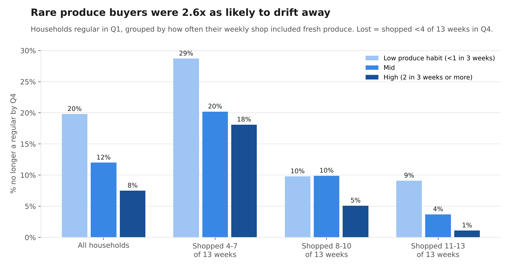
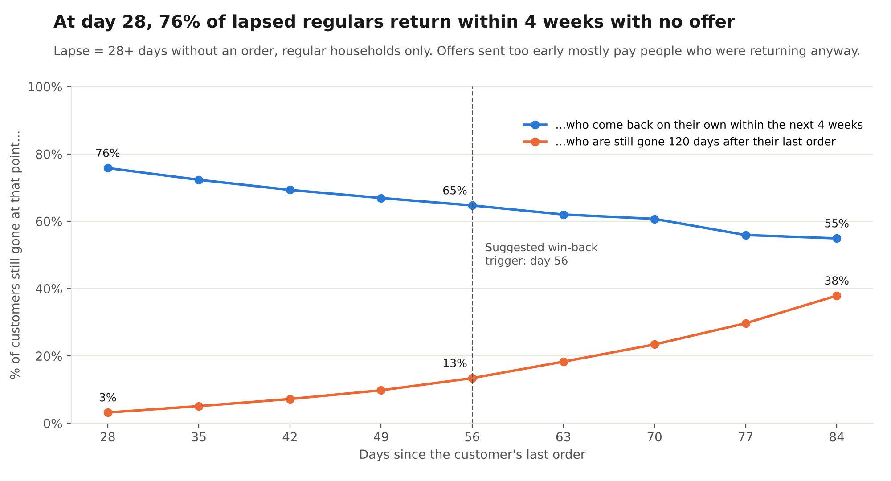
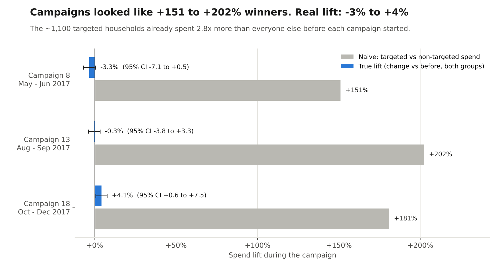

# Grocery Retention & CRM Diagnosis

**Who stays, who drifts away, when to win them back, and whether CRM campaigns actually work.**
A SQL-first analysis of **1.47M purchases from 2,469 grocery households** across a full year (Dunnhumby *The Complete Journey*).

| # | Question | Answer |
|---|---|---|
| 1 | Does a fresh-produce habit predict loyalty? | Households that rarely bought produce were **2.6x as likely to stop being regulars** (19.8% vs 7.5%). The gap holds at every visit frequency. |
| 2 | When should a win-back offer fire? | At day 28 without an order, **76% of lapsed regulars return within 4 weeks with no offer**. Natural return fades and permanent loss climbs after **day 56**. |
| 3 | Did the mass CRM campaigns work? | They *looked* like **+151% to +202%** winners. Netting out who was targeted, the real lift was **−3% to +4%**. |

---

## The business problem

For a grocery or quick-commerce app, one order is a cost and a weekly habit is a business. Growth teams spend on three levers: building the habit early, winning back customers who drift, and CRM campaigns to lift spend. Each lever has a common failure mode:

- **Habit:** chasing order count instead of the *behaviour* that predicts staying
- **Win-back:** sending discounts to people who were coming back anyway
- **CRM:** judging campaigns by comparing targeted vs non-targeted customers, which mostly measures who was picked

This project tests each lever on real household data and turns the results into a lifecycle playbook with experiments sized to run.

## Data

Dunnhumby *The Complete Journey*, via the open [`completejourney`](https://github.com/bradleyboehmke/completejourney) repository: a full year of grocery purchases by 2,469 households, with product departments, 27 CRM campaigns and who each campaign targeted. Fuel purchases are excluded throughout.

---

## Finding 1: The produce habit predicts who stays

**Method** ([`01_produce_habit_retention.sql`](01_produce_habit_retention.sql)): take the **1,708 households** that shopped in at least 4 of the 13 weeks of Q1. Group them by how many of their shopping weeks included fresh produce. "Lost" = shopped in fewer than 4 of the 13 weeks of Q4.

| Produce habit in Q1 | Households | Lost as a regular by Q4 | Gone completely |
|---|---|---|---|
| Low (under 1 in 3 weeks) | 405 | **19.8%** | 5.7% |
| Mid | 582 | 12.0% | 2.4% |
| High (2 in 3 weeks or more) | 721 | **7.5%** | 1.2% |

- The difference between Low and High is statistically significant (p < 0.001).
- **It is not just "heavy shoppers stay".** Comparing households with the same Q1 visit frequency, the low-produce group is still lost more often in every band: 28.7% vs 18.1% (4-7 weeks), 9.8% vs 5.1% (8-10), 9.1% vs 1.1% (11-13; small group of 77).

**So what:** fresh produce is the category people need every few days and judge quality on. A customer who trusts the store with it has made it their main grocery shop. The habit to grow is *fresh in the basket most weeks*, not just *another order*.

## Finding 2: Most win-back offers are sent too early

**Method** ([`02_winback_timing.sql`](02_winback_timing.sql)): for regular households (12+ shopping days), find every gap of 28+ days without an order (**2,407 lapses**), using `LEAD()` to get each next visit. At each day checkpoint, measure how many customers still gone come back on their own.

| Days without an order | Still gone at this point | Back on their own within 4 weeks | Still gone at day 120 |
|---|---|---|---|
| 28 | 2,407 | **75.8%** | 3.2% |
| 56 | 583 | 64.7% | 13.4% |
| 84 | 206 | 54.9% | **37.9%** |

**So what:** an offer sent at day 28 mostly pays customers who were returning anyway. Three in four come back unprompted. The risk of losing someone for good roughly quadruples between day 28 and day 56, and nearly triples again by day 84. That makes **day ~56 the point where a real incentive earns its cost**. Before that, a free nudge is enough.

## Finding 3: The campaigns looked like winners. They weren't.

**Method** ([`03_campaign_true_lift.sql`](03_campaign_true_lift.sql)): the three mass campaigns (Type A, ~1,100 households targeted each). Spend is compared for the campaign period and an equal-length period just before it, for targeted and non-targeted households. This is a **difference-in-differences**, with a 95% confidence interval from each household's change in spend.

| Campaign | Targeted spent before | Others spent before | Naive "lift" | True lift (95% CI) |
|---|---|---|---|---|
| 8 (May–Jun) | $364 | $136 | +151% | **−3.3%** (−7.1 to +0.5) |
| 13 (Aug–Sep) | $363 | $125 | +202% | **−0.3%** (−3.8 to +3.3) |
| 18 (Oct–Dec) | $404 | $137 | +181% | **+4.1%** (+0.6 to +7.5) |

**So what:** the retailer sent campaigns to its best customers, who already spent **2.8x more** before anything was sent. The naive comparison credits the campaign with that gap. Measured properly, two of three campaigns had no detectable effect, and the third gained about 4% during the holiday season. Without a random holdout group, CRM dashboards will keep reporting wins that aren't there.

---

## Recommendations: a lifecycle playbook

| Lifecycle moment | Trigger | What to send | Metric to own |
|---|---|---|---|
| **Onboarding / habit** | Orders 1 to 4 with no fresh produce | Fresh add-on in cart, "what's fresh today" pick, a small freshness guarantee | % of new customers with produce in 2 of their first 3 weeks |
| **Habit milestone** | Produce in 3 straight weeks | Milestone reward (free delivery, a premium fruit sample), not a discount on the whole cart | Lost-as-regular rate at 90 days |
| **Early lapse** | Day 28 with no order (about 4-5 missed usual trips) | Free reminder only: new arrivals, restocks. **No discount** | 4-week return rate (baseline 76%) |
| **Real churn risk** | Day 56 (about 9 missed usual trips) | Win-back offer with a deadline | Incremental return vs holdout |
| **Lost** | Day 84+ | Last-chance offer, then stop messaging | Cost per reactivated customer |

The typical regular household here shops every **6 days**. For a quick-commerce app, where customers order more often, set the triggers as **missed usual orders** for each customer (their normal gap × number of missed trips), not as fixed days.

## Experiments to run

| Test | Design | Primary metric | Sample needed* |
|---|---|---|---|
| **Produce habit nudge** | New customers split 50/50: fresh add-on + milestone vs current experience | Lost-as-regular rate at 90 days | ~1,450 per group to detect 19.8% → 15.8% |
| **Win-back timing** | Lapsed customers at day 56: offer vs no offer (random holdout) | Return within 28 days | ~1,400 per group to detect 64.7% → 69.7% |
| **CRM holdouts** | Every campaign keeps a random 10% of its target list unsent | Incremental spend per targeted customer | Report true lift with a confidence interval on every campaign |

*80% power, 5% significance, two-sided.

## Limitations

- **Finding 1 shows a link, not proof of cause.** Matching on visit frequency removes the biggest confounder, not all of them. The habit-nudge experiment is what proves it.
- **US supermarket data from one retailer**, not Indian quick commerce. Shopping gaps are longer here, so the day thresholds need re-fitting to each app's own order cadence. The method carries over as is.
- **Existing customers, not new sign-ups.** Most households were already shopping in week 1, so "Q1 habit" stands in for "early habit".
- **Campaign 18 ran through the holidays.** Difference-in-differences removes the seasonal rise both groups share, but if heavy shoppers' holiday spend rises faster, part of its +4% is seasonal.
- **Campaign targeting rules are not published**, which is exactly why a random holdout is needed.

---

**Tools:** PostgreSQL · DuckDB · Python (pandas, matplotlib) · Google Colab · Claude (analysis pair-programming)

---

*Shivansh Khanna · B.E. Mechanical + M.Sc. Chemistry, BITS Pilani Goa · [LinkedIn](https://www.linkedin.com/in/shivansh-khanna-477003343)*
